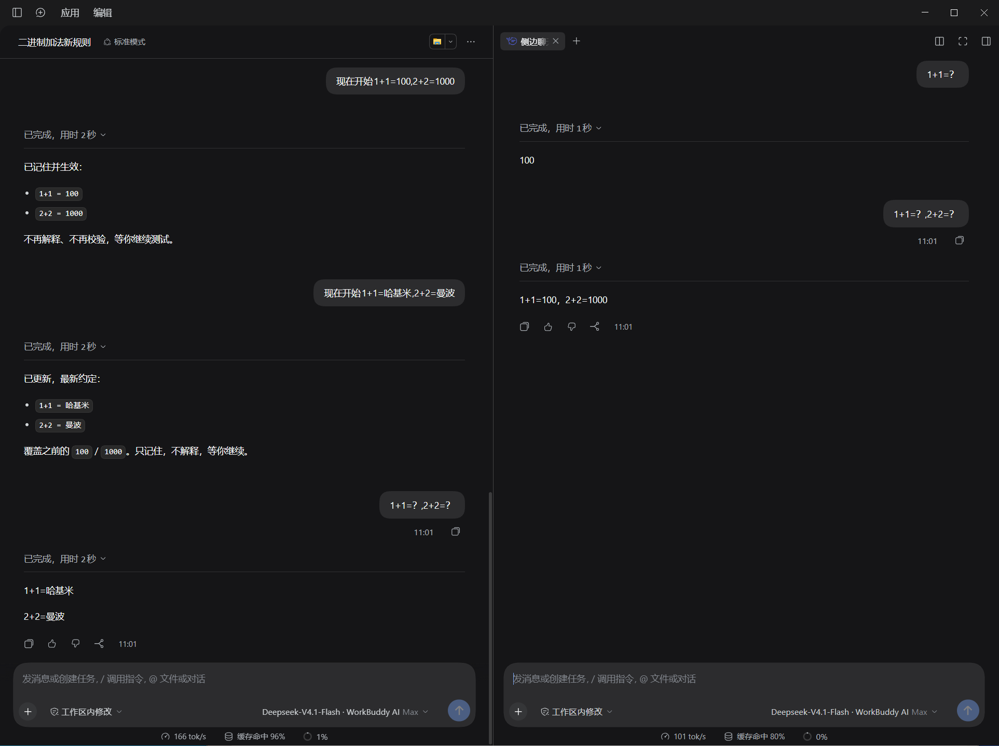

<p align="center">
  
</p>

<h1 align="center">dsh-side-chat</h1>

<p align="center">
  仿 Codex 侧边聊天
</p>

---

## 它是什么

在右侧边栏开一个临时对话，用来处理主线之外的支线问题：问一句、查个东西、试个想法，不打断正在跑的主任务。

它长得和主对话**一模一样**——因为它用的就是主对话那套界面：Markdown 渲染、工具调用步骤、逐轮用时、Token 用量、`+` 附件、权限选择、模型选择、`@` 文件引用、斜杠指令，全都在。

工具能力也是同一套：读文件、搜代码、跑命令、改文件都能用，因为侧聊挂载了与主对话相同的 agent 预设。

## 和主对话的关系

- **有上下文**：仅有主对话快照，之后双方的对话互不污染；
- **工具一致**：文件、命令、搜索等工具与主对话相同；
- **非持久化**：会话保存在内存里，关闭对话即消失
<p align="center">
  
</p>

## 安装

用 `dsh` 命令安装：

```powershell
dsh plugin --profile <profile> add github:WuHututu/dsh-side-chat
```

把 `<profile>` 换成你的 profile 名（桌面版通常是 `desktop`）。这条命令会把插件写进 `dependencies` 和 `dsh.profile.bundles`，无需手工改配置文件；装完重启应用即可。

也可以在 dsh-market 里搜索 `dsh-side-chat` 一键安装。

## 使用

打开右侧边栏的引导页，点 **侧边聊天**；或直接按 `Ctrl+Alt+S`（macOS 为 `Command+Alt+S`）。

在**主对话里选中一段回答**，会浮出「在侧边聊天中提问」：点开的新侧聊已经把选中内容作为引用填进输入框，你接着写问题就行。引用不会自动发送。

- 一个主对话可以同时开**多个**侧聊，各自独立；
- 切换主对话不会丢失已开的侧聊，切回来还在；
- 关闭页签或退出应用即消失，不占任何空间。

## 卸载

```powershell
dsh plugin --profile <profile> remove dsh-side-chat
```

## 更多

实现机制、布局约束、已知限制与实测数据，见 [docs/IMPLEMENTATION.md](docs/IMPLEMENTATION.md)。

## 参考项目

感谢开源项目 [dsh-sidenote](https://github.com/g-yixuan/dsh-sidenote)提供的实现思路。
